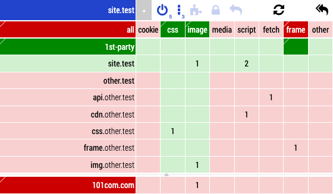

  

<h1 align="center">Crossbar</h1>

  
  
  

A point-and-click, matrix-based firewall for your browser: you decide, for each site you visit, which other sites it may connect to and what kind of content (cookies, CSS, images, media, scripts, XHR, frames…) each of them may send.

Definitely for advanced users.

  

Crossbar is a maintained fork of [uMatrix](https://github.com/gorhill/uMatrix) by Raymond Hill, which was archived in 2021. It was renamed so it isn't mistaken for the original. uMatrix was itself forked and refactored from [HTTP Switchboard](https://github.com/gorhill/httpswitchboard).

- **Chromium** builds use Manifest V3: rules are enforced with `declarativeNetRequest`. Compared with uMatrix:
  - The `Referer` header of third-party requests is removed instead of spoofed.
  - Partial IP addresses and IPv6 addresses can't be used as rule destinations.
- **Firefox** builds are still Manifest V2.

Packages are attached to [releases](https://github.com/dmolik/crossbar/releases). See [doc/README.md](doc/README.md) for installing them, and for bringing your settings over from uMatrix: a uMatrix backup file restores as is.

uMatrix's documentation still applies: [uMatrix's wiki](https://github.com/gorhill/uMatrix/wiki), and [HTTP Switchboard's documentation](https://github.com/gorhill/httpswitchboard/wiki), except for [uMatrix's differences with HTTP Switchboard](https://github.com/gorhill/uMatrix/wiki/Changes-from-HTTP-Switchboard).

Report bugs on the [issue tracker](https://github.com/dmolik/crossbar/issues).

## Warnings

#### Regarding broken sites

Crossbar does not guarantee that sites will work fine: it is for advanced users who can figure how to un-break sites, because essentially it is a firewall which works in relaxed block-all/allow-exceptionally mode out of the box: it is not unexpected that sites will break.

**So do not file issues to report broken sites when the sites are broken because Crossbar does its job as expected.**

**Using the logger is key to un-break sites:** the logger will show you all that Crossbar does internally.

Crossbar can be set to work in [allow-all/block-exceptionally](https://github.com/gorhill/httpswitchboard/wiki/How-to-use-HTTP-Switchboard:-Two-opposing-views#the-allow-allblock-exceptionally-approach) mode with a single click on the `all` cell in the global scope `*`, if you prefer to work this way. This will of course break less sites, but you would then lose all the benefits which comes with block-all/allow-exceptionally mode -- though you will still benefit from the hostnames blocked by the bundled hosts files.

## License

[GPLv3](LICENSE.txt).
